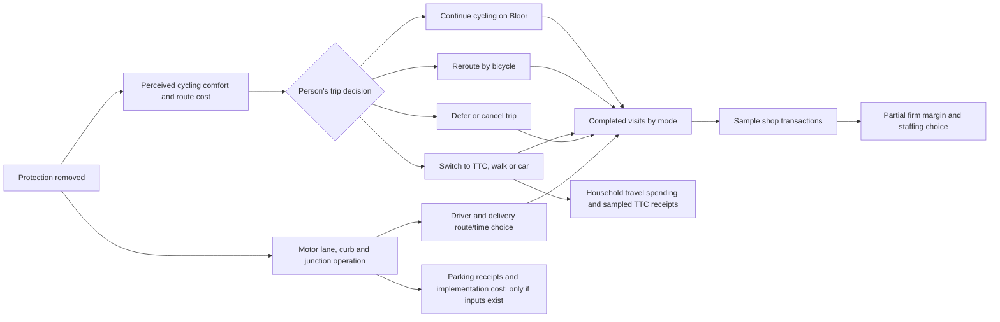

# Bloor bike-lane removal — second Toronto MVP demo

> **Geography update, 17 Oct:** The final prepared cycle-track question is now scoped to **Bloor St W, Bathurst St to Spadina Ave**, in the *same* detailed world and existing `/experience/` website as the TTC fare question. This brief studies the broader Shaw–Avenue corridor and historical installation evidence; retain it as research context. Do not relabel a wider count, merchant survey or installation effect as an observed removal response in the 619 m mapped section. See [`world/README.md`](./world/README.md) and the current [PRD](./prd.md).

**Status:** source-backed scenario design, 17 October 2026. This is a hypothetical intervention and a research fixture, not a measured removal outcome or a calibrated forecast. The [machine-readable fixture](./data/bloor_bike_demo.json) separates observed facts from model choices.

The independently prepared [11-source Bloor evidence pack](./bike-lane-papers.md), [observed Toronto baseline](./data/bloor_bike_lane_baseline.json), [evidence index](./data/bike_lane_evidence.json), and [offline EvidencePacket](./data/bike_lane_evidence_packet.json) add detailed intersection, census, and contrasting business evidence. The `B01`-style IDs in that pack and this brief refer to different local indexes; reconcile them by source URL and claim before joining them into a production packet.

## The 30-second pitch

> “What if the protected cycle tracks on Bloor Street West between Shaw Street and Avenue Road were removed and road space was returned to motor vehicles?”

The same hypothesis compiler, persona generator, world/event engine, city renderer, and economic dashboard used for the TTC fare demo should run this prompt. Zoom from the atmospheric city overview into a **schematic Annex/Korea Town section of Bloor**, then show distinct people making travel and shopping choices. Some cyclists continue on Bloor, some reroute, some switch to TTC or a car, and some defer a trip. Drivers and delivery vehicles may respond differently. Shops receive the resulting visits, not a hard-coded sales verdict. A sector graph reveals links among mobility, access, retail, household costs, public revenue, and safety. The crucial result is an inspectable range of possible tradeoffs and the evidence needed to decide, rather than a single “bike lanes cause X” number.

### Why this corridor

- The City’s original protected-lane pilot covered **2.4 km from Shaw Street to Avenue Road**, with 2016/17 counts and a detailed City evaluation. [City project page](https://www.toronto.ca/services-payments/streets-parking-transportation/cycling-in-toronto/cycling-infrastructure-definitions/bloor-street-bike-lanes/), [2017 evaluation](https://www.toronto.ca/wp-content/uploads/2017/10/8ef6-cycling-bloor-backgroundfile-107582.pdf).
- The City’s **2025 permanent counter west of Huron Street averaged 3,524 people cycling per day**. This is a single counter’s annual mean, not unique riders, shopping trips, or a corridor total. It is the freshest verified local scale cue in this brief. [2025 Toronto Cycling Year in Review, p. 9](https://www.toronto.ca/wp-content/uploads/2026/03/96e8-2025-Toronto-Cycling-Year-in-Review-FINAL.pdf).
- The City, local BIAs, the Toronto Centre for Active Transportation, and University of Toronto researchers studied visitors and merchants in the **Madison–Montrose** retail subarea. This makes the multi-hop business story concrete but also exposes attribution limits. [Original study](https://ero.ontario.ca/public/public_uploads/2024-10/Bloor-Economic-Impact-Study-Full-Report-2019-09-03_0.pdf), [peer-reviewed paper](https://doi.org/10.1080/01944363.2019.1638816).

**Art direction:** The 3D world is a **schematic Bloor microdistrict**, not a literal GIS map of all 2.4 km. Put a Bloor main street, protected tracks and then a proposal-state lane change, two cross streets, a subway entrance, a café/grocery, homes, and nearby alternate cycling routes. Label the wider corridor and BIA study area separately. The world may show a small sampled population; do not scale its outputs to the real corridor by multiplying by the counter.

## Observed evidence to put in source cards

| ID | Measured fact | Exact geography/time | What it can and cannot support |
| --- | --- | --- | --- |
| B01 | **3,524 cyclists/day** average at the permanent counter west of Huron Street; peak **7,953** on 16 Sep 2025. | One Bloor West counter, 2025 annual average/peak. [City 2025 review](https://www.toronto.ca/wp-content/uploads/2026/03/96e8-2025-Toronto-Cycling-Year-in-Review-FINAL.pdf). | Shows substantial present-day use at one point. It is not a count of distinct people, trips to local shops, or an estimate of what removal would do. |
| B02 | The 2016/17 pilot evaluation counted **3,309 to 4,925 cyclists per average 24 h** on Bloor between Shaw and Bay, and separately **5,220 average weekday cyclists** within the pilot. Harbord and Dupont cycling counts fell; the City estimated only about a quarter of Bloor’s increase was newly cycling there rather than rerouting. | Before June 2016 and after June 2017; count methods/geographies differ. [City 2017 evaluation, pp. 7–8](https://www.toronto.ca/wp-content/uploads/2017/10/8ef6-cycling-bloor-backgroundfile-107582.pdf). | Demonstrates network rerouting and induced cycling after **installation**. Never invert the 49% or 56% as a removal elasticity, or compare these summer counts directly with B01’s annual mean. |
| B03 | Bloor motor vehicles changed from **24,322 to 20,434 per average 24 h** in June 2016/17; Dupont rose by **1,467**, Harbord by **584**. After signal adjustments, Bloor travel time relative to June 2016 was **+2:00 eastbound AM** and **+4:15 westbound PM**. | Historic installation evaluation on specified corridors and peaks. [City 2017 evaluation, pp. 10–11](https://www.toronto.ca/wp-content/uploads/2017/10/8ef6-cycling-bloor-backgroundfile-107582.pdf). | Network traffic and driver time matter. These are not predicted savings from removal: demand, junction operations, and the street layout have changed since 2017. Include a zero driver-time-gain sensitivity case. |
| B04 | A three-intersection before/after video analysis found **44% fewer conflicts across all road users** after installation; bike–motor vehicle conflicts decreased, while bike–pedestrian conflicts increased. A later City comparison reported cyclist injury collisions averaging **20/year in 2008–15** versus **15/year in 2017–24**, amid higher cycling volumes, with an estimated **56% lower cyclist collision rate**. | Historic pilot, with differing observation windows and City analysis. [City 2017 evaluation, p. 9](https://www.toronto.ca/wp-content/uploads/2017/10/8ef6-cycling-bloor-backgroundfile-107582.pdf), [City 2024 supplemental report, pp. 11–12](https://www.toronto.ca/legdocs/mmis/2024/cc/bgrd/backgroundfile-250545.pdf). | Supports a safety concern and an **exposure/conflict question**. It does not yield a valid count of future injuries or deaths if tracks are removed; the game must never animate a predicted crash. |
| B05 | The retail study collected **3,005 visitor surveys, 525 merchant surveys, and 15 bicycle counts** before/after installation, with Danforth as a comparator. Bloor visitor cycling share was **7% before to 20% after**; walking was **48%** and driving **10%** in the after survey. Reported spend and visits rose, but Danforth also improved; the authors explicitly say causes other than the lane may explain the positive result. | Madison–Montrose retail study area, 2015–17 surveys. [Original study, executive summary](https://ero.ontario.ca/public/public_uploads/2024-10/Bloor-Economic-Impact-Study-Full-Report-2019-09-03_0.pdf). | Grounds mode-specific visitors and contradictory merchant perspectives. No bike-lane-removal-to-sales coefficient or automatic store closure. Survey respondents are not a representative 2026 count. |
| B06 | Moneris pilot-area transaction value grew **4.45%** in the installation year, against **3.73%** nearby, **2.21%** on Danforth, and **4.96%** citywide. The City also reported mixed business opinion and roughly unchanged aggregate paid-parking revenue as off-street use and pricing changed. | Pilot and comparison areas, 2016/17. [City 2017 evaluation, pp. 12–15](https://www.toronto.ca/wp-content/uploads/2017/10/8ef6-cycling-bloor-backgroundfile-107582.pdf). | Shows retail and parking accounting require a control and substitutions. Cannot be reversed into future retail loss or a parking-revenue gain. |
| B07 | The City’s 2024 assessment said restoring motor lanes across **Bloor, Yonge and University combined** would entail substantial reconstruction and estimated **over $48 million for all three corridors**, at preliminary order-of-magnitude level. It expected construction disruption and likely minimal eventual driver travel-time improvement. | Multi-corridor, 2024 proposal; **not** a cost estimate for our 2.4 km demo. [City 2024 supplemental report, pp. 1, 12–13](https://www.toronto.ca/legdocs/mmis/2024/cc/bgrd/backgroundfile-250545.pdf). | Include implementation and construction as a decision-brief gap. Do not display $48m as a Bloor-segment cost or treat the City’s judgment as a measured post-removal result. |

## Simulation: the branching causal graph

The proposed change is **remove the physical cycling separation on Shaw–Avenue, with an illustrative reallocation toward motor vehicles**. That geometry is a scenario input, not a currently approved engineering drawing. Baseline and proposal start from the same sampled households, businesses, routes, weather, and seed; only the policy and consequent choices differ. A 2015-like four-lane image may communicate the policy switch, but the product must label it **schematic** because reconstructed sections could require major work to restore. [City 2024 supplemental report](https://www.toronto.ca/legdocs/mmis/2024/cc/bgrd/backgroundfile-250545.pdf).

**Model the competing channels.** A rider who stops cycling may still reach the same café by subway; a driver might find an easier pickup; a courier may lose a direct protected route; a shop may see a changed visitor mix but unchanged revenue. Harbord/Dupont are actual historical alternate corridors, but their capacity and 2026 route suitability must be checked before treating them as substitutes. The shop owner’s staffing decision comes *after* event-derived transactions and an explicit margin rule. No shop closes by narrative fiat.

### Useful people to make visible

| Role | Real decision shown in the city | Economic or access effect to inspect |
| --- | --- | --- |
| Less-confident bicycle commuter | Continue on Bloor, detour, transit, or skip a nonessential stop. | Trip time and fare or parking cost; visit destination. |
| Experienced delivery rider | Accept a longer alternate route or ride in mixed traffic. | Deliveries completed, time per delivery, potential earnings **only if** paid-job rules exist. |
| Driver with a heavy purchase | Route and parking/pickup choice after lane reallocation. | Travel time, parking spend, chance of reaching a shop. |
| Transit rider / person who cannot cycle | Decide whether a changed transfer or curb condition matters. | Accessibility is not reducible to cycle count. |
| Café or grocer owner | Observe actual arrivals and sales, then adjust hours or inventory. | Sample sales and partial margin; no unmeasured closure claim. |
| Delivery van operator | Choose loading window, curb location, or alternate route. | Delivery time and costs, potentially shop inventory. |
| City analyst | Compare phase, groups, and missing data; approve an assumption rerun. | Decision brief and genuinely human research contribution. |

### What the dashboard may claim

All quantities below must come from `WorldEvent`s in one `RunResult`, with baseline, proposal, unit, sample denominator, horizon, and evidence tier. The 2025 counter is a cited context card; it is **never** an output of the simulated 12–24 people.

| Sector | MVP metric | Calculation / caveat |
| --- | --- | --- |
| Mobility | Completed sampled trips by bike-Bloor, bike-detour, TTC, walk, car, and no-trip; mean sampled travel minutes. | Aggregate recorded trip choices and arrival events. State the sampled-person/day denominator. Include a “no driver time benefit” case. |
| Access | Sampled people who reach work, school, shops and services; extra route minutes by persona group. | Count completed destination events; no citywide access claim without a transport network model. |
| Local economy | Visits and transactions by transport mode; sample shop gross sales and **partial** margin. | Record only actual shop-enter and purchase events; margin is sales less **modelled** costs. Show zero retail-response sensitivity; never extrapolate to all Bloor merchants. |
| Households / TTC | Sampled travel spending and TTC fare receipts from people who switch mode. | Ledger transfer: rider payment = TTC receipt. Reuse valid fare rules if integrated; do not count TTC revenue as social benefit. |
| Curb/public budget | Parking payments if a space inventory, price, and parking event exist; segment construction/removal cost. | Mark **not estimable** if inputs absent. The City’s >$48m is for three full corridors, not this scenario. |
| Safety and environment | Cycling exposure / mixed-traffic minutes as **modelled risk proxies**; emissions only if trip distances, substituted modes and factors exist. | Do not output predicted crashes, injuries, fatalities or CO₂ from the historic before/after figures. |

**Sensitivity controls shown to the judge:** (1) cycling response from little to substantial rerouting/mode shift, (2) driver travel-time gain from zero to a positive hypothetical case, (3) shop purchase conversion from unchanged to a changed visit mix. These are **illustrative settings**, not Toronto confidence intervals. The agent should propose the next evidence collection step: current person-trip origins/destinations and purpose, current business sales by mode, traffic engineering for the removal design, and a safety/exposure assessment.

## 3D and interaction cues for Aadit / Meet

1. **Cloud descent:** City at overview scale; user hypothesis sits in the centred chat. As the prompt compiles, source chips appear: “2025 Bloor counter,” “2017 pilot,” “Bloor business study.”
2. **Camera target:** Fly to Bloor West near Bathurst / Huron with the larger Shaw–Avenue corridor outlined. A label states “schematic district; real Toronto source data.” Buses/people/shops may share the renderer, but a TTC bus must not be implied to run on this exact Bloor block if the route data do not support it; show a subway entrance here or put the bus on a labelled cross street.
3. **Policy moment:** Baseline protected tracks glow, then the proposal overlay depicts their removal. Tag the frame “hypothetical street layout.” Do not silently show an immediate rebuilt road; use a brief planning/construction phase badge or skip to a labelled steady-state scenario.
4. **Follow an agent:** Click the less-confident cyclist. Show the actual event chain: `policy_changed → choose_route/mode → depart → arrive_or_defer → enter_shop_or_not`. Animate only committed events. A highlighted alternate route can explain a shop’s altered visitor mix.
5. **Show the counterchannel:** Click the driver/delivery van; highlight any time, parking or loading benefit **computed in the same run**. If the assumed driver benefit is zero, the scene and metric must say zero.
6. **Sector graph:** Nodes are **Mobility, Access, Retail, Household/TTC, Curb/Public Budget, Safety**. Selecting an edge filters agent paths and the corresponding event-derived charts. Do not use a decorative edge to assert a causal parameter that the model lacks.
7. **Decision drawer:** 3–5 deltas with assumption badges, a baseline/proposal mode chart, a group comparison, sample shop margin and travel spending, and the zero/low/high sensitivity view. Put B01 and B05 in clickable evidence cards beside the affected metrics.

## Papiers investigation that earns the primary track

Have a teammate actually save and annotate the [Arancibia et al. Bloor paper](https://doi.org/10.1080/01944363.2019.1638816) and the [TCAT original study](https://ero.ontario.ca/public/public_uploads/2024-10/Bloor-Economic-Impact-Study-Full-Report-2019-09-03_0.pdf) if Papiers supports that document. The agent’s question should be: **“Can an installation study justify predicting that removal will reduce this café’s sales?”** A strong evidence evaluation answers that the papers support a plausible route-to-visit mechanism but do **not** identify a reverse removal coefficient; the Danforth comparison also changed. The agent proposes a zero-retail-effect sensitivity and a current merchant/customer study. A real human then accepts, edits or rejects that proposed assumption and reruns. Do not prefill a fabricated human note or claim the papers are already in the Papiers library.

## Decision boundaries / gaps

- **No inverse treatment effect:** Historic installation changes are context, not a numerical forecast for removal. Demographics, network, Bike Share, e-bikes, business mix, street design and travel patterns have changed.
- **No automatic car benefit:** The City’s 2024 engineering assessment expects construction disruption and likely little eventual driver-time improvement. The model should test possible benefit as an assumption, not promise it.
- **No shop-loss prediction:** The retail study’s positive Bloor outcomes overlapped with growth on Danforth. A changed visitor mix does not identify causal sales or closures.
- **No injury or emissions forecast:** Conflict counts and injury rates are evidence for risk assessment, not enough for a new corridor-specific fatality or CO₂ estimate.
- **No citywide scaling:** One permanent counter and a tiny simulated district cannot supply representative expansion weights. If only 12–24 synthetic people are in the run, title charts “illustrative sample.”
- **Date/geography warning:** 2016/17 Bloor counts, 2025 Huron counter and Madison–Montrose shopper surveys cover different periods and extents. Display them in separate cards, never on one unlabeled trend line.
