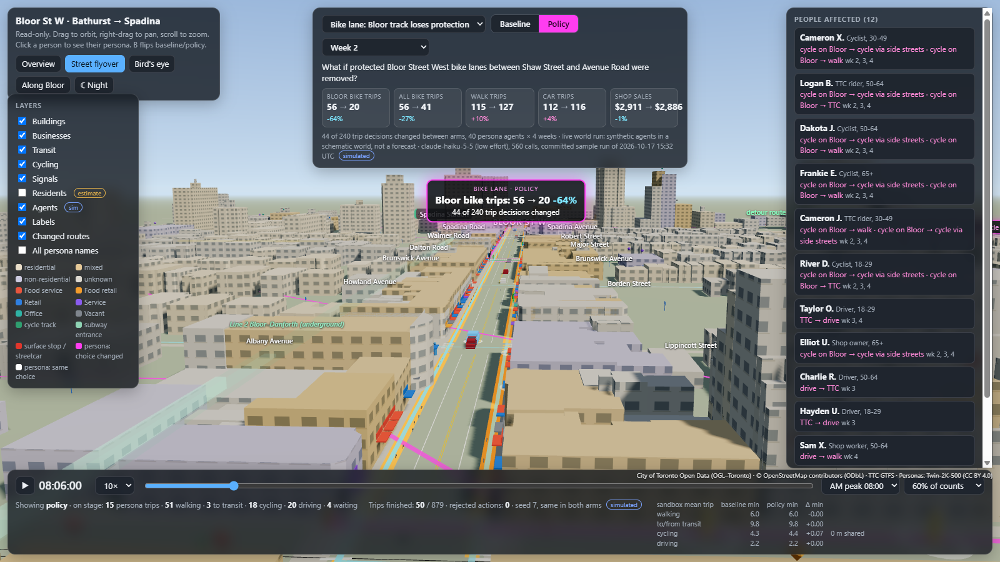

# Bloor 3D viewer

An interactive three.js view of the Bloor St W sandbox world (Bathurst St to Spadina Ave). It is **read-only**: it loads `data/world/bloor_spadina_bathurst.json`, deep-clones and freezes it, and never writes to it. It also loads `world/sandbox.js` unchanged to replay a seeded run.



```sh
python -m http.server 4173          # from the repository root
# open http://127.0.0.1:4173/world/viewer3d/
```

`standalone.html` is the same page with the world JSON, `sandbox.js` and `viewer.js` inlined, for sharing as one file. It opens straight from disk. three.js (`0.160.0`, pinned) still loads from cdn.jsdelivr.net, so it needs a network connection. Rebuild it after changing the viewer or the world:

```sh
node world/viewer3d/build-standalone.mjs
```

## Inside /experience/

The lab's city viewport opens this viewer in 3D by default, through `experience/viewer3d-bridge.js`; a 3D/2D button switches back to the 2D map. `?view=2d` starts on 2D.
- The bridge passes the page's own `experiment.v2` RunResult, taken from `counterfactual:result`, to `?embed=1`. The 3D people are the run's synthetic people, and each travel event's recorded sandbox steps are drawn as they are. The 3D view, ledger and charts therefore read one event log.
- The page's Baseline / With policy toggle and the decision ledger drive the 3D view, which flies to the person on the clicked row.
- Playback skips the empty hours between the run's travel.

The standalone page below keeps the persona-swarm runs. For the demo it shows only the scenario picker, Baseline/Policy, three numbers, the people list and a short persona card. The Layers button reveals the rest.

## The two demo scenarios, with personas

The selector at the top switches between the persona runtime's two prepared runs (Steven's `persona-swarm/runtime`, which drives Meet's paired experiment). **Baseline / Policy** (or the B key) flips arms at the same moment, with the same seed.

| Scenario | Back-end run | Policy arm in the sandbox | On the street |
| --- | --- | --- | --- |
| Bike lane | `run-bloor`: the Bloor cycle track **loses its protection** (hypothetical) | `bloor_cycle_track: painted` | Posts vanish, the track turns pulsing amber, and the side-street detour routes are labelled |
| TTC fare | `run-fare`: adult fare +$0.50 ($3.30 → $3.80), Fair Pass unchanged ($2.10) | `adult_fare_cad: 3.80`; persona riders pay their own fare category | Fare tags on every Line 2 entrance and 510/511 stop, red and pulsing in the policy arm; entrances glow red |

- **Headline tiles** show the run's own event-derived totals over 4 weeks for 40 persona agents, from `totals`, plus the count of changed trip decisions.
- **Persona agents** are the run's 40 deciders, drawn bright with a ring. Magenta means their choice for this trip differs between arms in the chosen week, and yellow means selected. Each trip's mode is the persona agent's own `choose_trip` choice. Its route, timing and waits come from `world/sandbox.js`, and `bike_detour` trips ride the City cycling network's side streets: Barton/Lowther to the north, Harbord to the south.
- **Routes:** for changed or selected people, magenta is this arm's route and cyan is the same trip in the other arm.
- **People affected** lists everyone whose choice changed. Clicking a name flies to them. The **persona card** shows their name and role, age band and sex, income and weekly cash, car, bike and fare category, a real Bloor workplace if they have one, the "relative profile" traits from their own survey answers, each trip in both arms with the agent's stated reason, and their fare-poll stance.
- **Background traffic** is the same count-driven sandbox traffic as before, identical in both arms.

`personas.json` is built from the committed samples and `agents.json`. Rebuild it after a new run (add `--live` to prefer saves in `persona-swarm/data/city/live/`):

```sh
node world/viewer3d/build-personas.mjs
```

When the page is served by the persona server (`npm --prefix persona-swarm/runtime start`, then http://127.0.0.1:4174/world/viewer3d/), a **Load latest live run** button reads `GET /replay/latest`. These are read-only GETs with no model calls.

**Illustrative, not data:**
- Home placement: a residential building in the persona's own neighbourhood, picked by hash.
- Trip departure times within the 30-minute window.
- Cars and bikes stop at the side street nearest a shop.
- Detour geometry.

The back-end runs a schematic world, not this map, so persona choices are replayed on James's map rather than decided on it.

## What you see, and where it comes from

| Layer | Data | Status |
| --- | --- | --- |
| Buildings | 925 footprints extruded to `height_m` (City 3D Massing 2025), coloured by `use` | observed geometry, derived use |
| Residents | `residents_est` per building and the 25 m `population.grid` | derived estimate |
| Streets | Bloor curb at ±8.8 m (from the crosswalks across Bloor), side streets from intersection legs and nearby signals, sidewalks, laneways and walkways from `walk_network` | observed, simplified |
| Crosswalks | `crosswalks.items` endpoints, drawn as ladder bars | observed |
| Cycling | Bloor cycle-track paint from `cycling_network` Bloor St W "Cycle Track" segments, other routes, Bike Share docks, bike parking | observed |
| Transit | Line 2 entrances at their OSM positions, platforms and tunnel drawn faintly underground, surface stops from `surface_departures` | observed |
| Businesses | 243 businesses: awnings on Bloor frontages, pins above buildings elsewhere, tinted by category | observed presence |
| Signals | Poles at the 4 Bloor signals, with heads showing `signalAt(px, t)` from the sandbox; the 7 other signals are drawn unlit | observed location, **assumed** timing |
| Agents | Walkers, transit riders, cyclists and cars from a seeded `createSandbox` run | simulated |
| Streetcars and trains | 510 and 511 streetcars, Line 2 trains | scheduled (GTFS) |

Click anything to open the inspector. Each value carries an observed, derived, assumed or simulated tag.

## What is animated

- **Agents run in the sandbox.** For the chosen 30 minutes (08:00, 12:30 or 17:00), the viewer spawns agents from the observed 15-minute `section_flows`, scaled to 15–100%. It spawns cars and cyclists entering each end, walkers along Bloor (60% walk to a business door and `enter` it), walkers crossing at Bathurst and Spadina, and some transit riders. Each one calls `sb.travel()`, and the viewer animates the resulting `moved` events along the sandbox graph edges. Pedestrians wait at the walk signal, and vehicles queue at the stop line, exactly as long as the events say. Transit riders vanish down the station stairs and ride Line 2 at the sandbox's scheduled departure. The seed is fixed (7), so every replay is identical.
- **Sandbox-only policy rerun.** In the Sandbox scenario, the cycle-track select reruns the sandbox with `bloor_cycle_track` set to `protected`, `painted` or `none`, using the same seed and spawn plan. It also runs the baseline, and the dashboard shows the mean trip minutes for both, plus metres cycled in car lanes. The street drops the posts or paint to match.
- **Streetcars and Line 2 come from GTFS, not the sandbox.** Departure times are spaced evenly within each hour from `trips_by_hour`. This is the same rule `sandbox.js` uses for boarding, so trains leave just as riders board. Line 2 speed comes from the observed median run time between platforms. Streetcars use an assumed 6 m/s with no dwell, and the 510 descends into the Spadina Station loop.
- **Signals** change colour from `sandbox.signalAt()`, which uses the assumed 90 s plan.

Hash parameters set the view, which is useful for links and screenshots: `#scenario=fare&arm=policy&week=2&person=a025&preset=flyover&t=08:12&night=1&pause=1`, or a camera as `cam=x,y,h,targetX,targetY,targetH` in world metres.

## Coordinates

The world's own frame is used throughout: x is metres east along Bloor from the Bathurst centreline, and y is metres north of the Bloor centreline. In three.js these map to `X = x`, `Y = height` and `Z = -y`. GTFS stop latitudes and longitudes are converted with the same transform as `world/build/section.py`. The sandbox cross-section is schematic: car lanes at ±3 m, the cycle track at ±7 m and sidewalks at ±12 m. For display only, the viewer maps those offsets to ±1.7, ±7.5 and ±10.9 m, so agents sit inside the drawn 17.6 m curb-to-curb street. Side-street agents run straight along each intersection's x.

## Not used, or used only partly

- `counts.intersections` (raw turning movements) are not drawn. The viewer uses the derived `section_flows` instead.
- `bloor.segments` lane tags are not drawn lane by lane. The street shows one lane each way plus the cycle track.
- `car_parking` is drawn as signs only, because lots have points but no polygons.
- `walk_network` sidewalk lines are drawn, but road widths come from OSM road class, not from measurements.
- The positions of entrances and stations in the sandbox graph are schematic. Agents use the stairs at the sidewalk, while the pavilions sit at their real OSM points.
- At night, lit windows and the glow on the pavement are decorative, not data.
